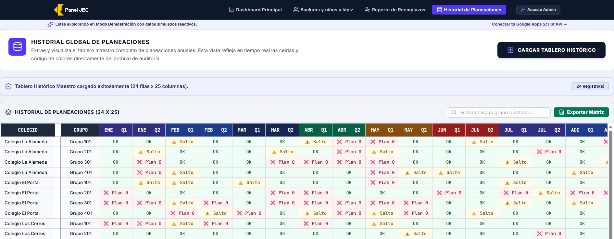

<div align="center">

# Panel JEC

**Dashboard de gestión para programas educativos: consolida asistencia, planeaciones, refrigerios y docentes a partir de fuentes de datos (CSV / Google Sheets / Google Drive).**

</div>

---

Panel web construido para el equipo operativo de un programa educativo colombiano: reemplaza la revisión manual de decenas de hojas de cálculo por un dashboard único, con indicadores, alertas y reportes exportables por mes y por colegio.

La aplicación funciona con **una base de datos de demostración en archivos CSV** desde el primer minuto, de modo que cualquiera puede clonarla, ejecutarla y evaluarla sin acceso a información privada: el código no contiene ningún dato, solo lee las tablas.

## Características

**Reportes operativos**
- **Alertas diarias**: planeaciones faltantes, inasistencias y errores de documento por grupo y fecha.
- **Novedades NL (niños a lápiz)**: seguimiento de estudiantes con novedades de asistencia.
- **Planeaciones**: detección de saltos, retrocesos y errores de secuencia en los archivos de planeación.
- **Refrigerios**: estudiantes que asistieron sin registrar entrega de refrigerio.
- **Docentes**: cambios de docente sin reemplazo y alertas por quincena (Q1/Q2).

**Módulos adicionales**
- **Análisis NL**: conteo de asistencias por estudiante, detección de registros duplicados y búsqueda por número de documento.
- **Reporte de reemplazos**: histórico de docentes de reemplazo por colegio, grupo y fecha.
- **Historial de planeaciones**: matriz consolidada de la operación planeada vs. ejecutada.
- **Backups de listas**: generación de copias de respaldo en Drive con procesamiento por lotes y reanudación automática (triggers).
- **Niños en cero**: identificación de estudiantes sin registros de asistencia en la quincena.

**Experiencia de uso**
- Filtros cruzados por mes y por colegio (multi-selección).
- Búsqueda instantánea y ordenamiento por columna en todas las tablas.
- Exportación de cualquier reporte a **Excel (.xlsx)** y **CSV**.
- Barra de progreso en tiempo real durante la sincronización, con cancelación por parte del usuario.
- Pantalla de configuración protegida por contraseña (modo administrador).
- **Modo demo** alimentado por las tablas CSV, para explorar la interfaz sin conectar servicios.

## Decisiones técnicas destacadas

| Reto | Solución implementada |
| --- | --- |
| Separar los datos del código | Los registros de la demo viven en **tablas CSV** (`public/data/`); el código solo contiene lógica de negocio y las lee con un parser CSV propio |
| Apps Script tiene un límite de ~6 minutos por ejecución | Los colegios se procesan en **lotes** (`fetchReportDataInBatches`), con reintentos y consolidación en el cliente |
| Peticiones largas que se quedan colgadas | `AbortController` + timeout configurable (por defecto 360 s) y cancelación manual desde la UI |
| Visibilidad del avance en sincronizaciones largas | Servicio de progreso con *polling* (`getProgress`) y barra de avance con colegios procesados |
| Respaldo de cientos de archivos en Drive | Copias por lotes con **triggers** que reanudan el trabajo pendiente entre ejecuciones |
| IDs de Drive fuera del código | Las claves de carpetas se leen de **Script Properties** (`PropertiesService`), nunca en el código ni en el repositorio |
| Datos sensibles de menores de edad | Ningún dato real en el repositorio: la demo se alimenta de tablas CSV ficticias y la conexión real se configura en tiempo de ejecución |

## Base de datos de demostración (CSV)

La "base de datos" del modo demo es un pequeño modelo relacional en archivos CSV planos dentro de `public/data/`:

| Tabla | Contenido | Rol |
| --- | --- | --- |
| `colegios.csv` | Catálogo de colegios | Dimensión |
| `grupos.csv` | Catálogo de grupos | Dimensión |
| `docentes.csv` | Catálogo de docentes (anonimizado) | Dimensión |
| `estudiantes.csv` | Pool de nombres y apellidos para generar registros | Dimensión |
| `registros_nl.csv` | Registros del módulo Análisis NL (conteo, duplicados, búsqueda) | Tabla de hechos |

La conexión se hace en `src/dataService.ts`:

1. **`parseCSV()`**: parser de CSV escrito desde cero (soporta comillas, comas y saltos de línea escapados), sin depender de ninguna librería.
2. **`loadDemoDatabase()`**: descarga las 5 tablas con `fetch()`, las convierte en objetos, normaliza los tipos (números, nulos) y **cachea** el resultado para que cada tabla se descargue una sola vez por sesión.
3. Los componentes consumen `loadDemoDatabase()` igual que consumirían el backend real: `generateMockReportData()` arma los reportes del dashboard a partir de las tablas, y los paneles de análisis leen `registros_nl.csv`.

En producción, la misma interfaz la cumple el backend de Google Apps Script (`services/apiService.ts`), que lee Google Sheets y Google Drive: cambiar de fuente de datos no exige tocar la interfaz.

## Estructura del proyecto

```
├── google-apps-script/
│   └── Code.gs              # Backend: API JSON sobre Drive y Sheets (doPost/doGet)
├── public/
│   ├── data/                # Base de datos de demostración (5 tablas CSV)
│   │   ├── colegios.csv
│   │   ├── docentes.csv
│   │   ├── estudiantes.csv
│   │   ├── grupos.csv
│   │   └── registros_nl.csv
│   └── _redirects           # Fallback SPA para Netlify
├── src/
│   ├── components/          # Componentes de UI (paneles, tarjetas, tablas)
│   ├── dataService.ts       # Capa de datos: parser CSV + carga y caché de tablas
│   ├── services/
│   │   └── apiService.ts    # Cliente HTTP del backend: batching, timeouts, progreso
│   ├── types.ts             # Tipos de dominio
│   ├── utils.ts             # Generación de reportes demo a partir del CSV + utilidades
│   ├── App.tsx              # Estado global, navegación y sincronización
│   └── main.tsx
├── index.html
├── netlify.toml             # Build y headers de seguridad para Netlify
└── package.json
```

## Stack técnico

TypeScript · React · Vite · Tailwind CSS · Google Apps Script (backend) · Google Sheets y Drive (datos en producción) · CSV (datos de la demo) · SheetJS (exportación a Excel) · Netlify (despliegue).

## Ejecución local (modo demo)

Requisitos: Node.js 18+ y npm.

```bash
# 1. Clonar el repositorio
git clone https://github.com/juandaramirez43/PANEL-JEC.git
cd PANEL-JEC

# 2. Instalar dependencias
npm install

# 3. Levantar el entorno de desarrollo
npm run dev
```

Abre `http://localhost:5173`. La aplicación arranca en **modo demo** leyendo las tablas CSV: puedes explorar reportes, filtros, búsqueda, ordenamiento y exportación sin configurar nada. También puedes abrir los archivos de `public/data/` directamente en Excel para ver (o ampliar) la base de datos demo.

## Conexión con datos reales

Si quieres conectar el panel a tus propias hojas de cálculo:

1. Crea una hoja de Google y un archivo de Apps Script con el contenido de `google-apps-script/Code.gs`.
2. Define los IDs de tus carpetas de Drive como **propiedades del script** en Apps Script (Configuración del proyecto → Propiedades del script), con las claves `API_ID_CARPETA_RAIZ`, `ID_ARCHIVO_SEGUIMIENTO` e `ID_CARPETA_COPIAS`. Así los IDs reales nunca quedan en el código ni en el repositorio.
3. Publica el proyecto como **aplicación web** (implementar → nueva implementación → aplicación web, acceso: solo tu cuenta) y copia la URL `https://script.google.com/...`.
4. En el panel, entra a **Conectar tu Google Apps Script API**, desactiva el modo demo, pega la URL y guarda.

## Despliegue

El repositorio incluye `netlify.toml` listo para Netlify (build con Vite y fallback SPA). También funciona en Vercel o cualquier hosting estático:

```bash
npm run build   # genera la carpeta dist/ (incluye las tablas CSV de public/data/)
```

## Capturas

| Dashboard principal | Backups y niños a lápiz |
| --- | --- |
|  |  |

| Reporte de reemplazos | Historial de planeaciones |
| --- | --- |
|  |  |

| Configuración de conexión |
| --- |
|  |

## Autor

Desarrollado por [Juan David Ramírez](https://github.com/juandaramirez43), ingeniero civil en Bogotá, Colombia, enfocado en **análisis de datos e ingeniería de datos**: modelado de datos, procesamiento por lotes, calidad y validación de registros, y automatización de reportes con Google Workspace.

El panel se desarrolló principalmente con **Google AI Studio y Gemini**, que asistieron en la escritura del código.

---

## English summary

**Panel JEC** is an operations dashboard for a Colombian educational program. It replaces manual spreadsheet reviews with a single web dashboard that consolidates attendance, lesson-planning, snack-delivery and teacher data stored across Google Sheets files in Google Drive, filtered by month and school.

- **Stack:** TypeScript, React, Vite and Tailwind CSS on the frontend; a Google Apps Script Web App as a JSON API over Drive and Sheets, so there are no servers to maintain.
- **Data layer:** demo mode runs on a small relational database of flat CSV files (`public/data/`): schools, groups, teachers, students and a fact table of attendance records. They are loaded by a hand-written CSV parser (`src/dataService.ts`) with in-memory caching, so no data is hardcoded in the app logic.
- **Notable engineering:** batched processing to work around Apps Script's execution time limit, `AbortController`-based timeouts and cancellation, real-time progress polling, Drive backup jobs resumed through Apps Script triggers, and Excel/CSV export.
- **Demo mode:** the app runs on simulated data out of the box, so no private data or data about minors is included in this repository. Clone it, run `npm install` and `npm run dev`, and explore.
- **Built with AI assistance:** the code was developed mainly with Google AI Studio and Gemini.
